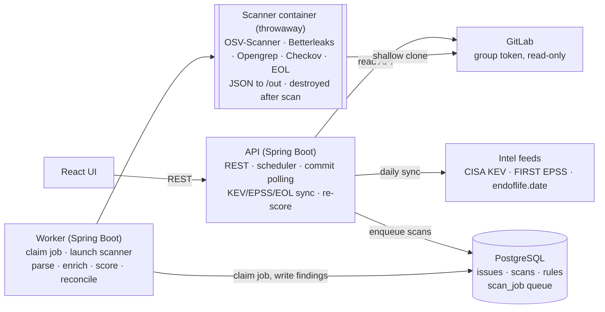
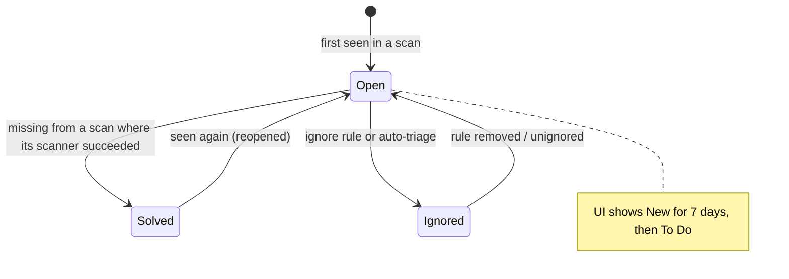

# SecScan — Repo Scanning MVP Spec

Source of truth for what we build. Exported from the planning doc on 2026-10-11.
If code and this spec disagree, the spec wins until a decision in `docs/DECISIONS.md` changes it.

## Overview and scope

The MVP is an internal, self-hosted tool that connects to our GitLab, scans selected repositories daily and on new
commits, and shows one deduplicated, prioritized issue feed. It copies the repository-scanning part of Aikido only;
everything else waits.

**In scope (MVP)**

- GitLab (self-managed or gitlab.com) connection with a read-only token
- Ecosystems: Java (Spring Boot, Maven and Gradle), .NET (NuGet), JavaScript/TypeScript (npm, yarn, pnpm, bun)
- Scan types: open-source dependencies (SCA), secrets, SAST, IaC, end-of-life runtimes and frameworks
- Grouped issue feed, severity scoring 0–100, auto-triage with visible reasons, manual ignore rules,
  solved/reopened lifecycle
- Dashboard, repository list with scan-health warnings, manual and scheduled scans

**Out of scope (later phases)**

- Merge request checks and pipeline gating
- AutoFix (opening MRs), reachability analysis, AI triage
- Containers, cloud (CSPM), DAST, runtime protection
- Jira/Slack, SLAs, SSO, multi-tenant SaaS (the data model is tenant-ready from day one)

## Reference behaviors from Aikido

Aikido's value is orchestration and triage on top of mostly open-source engines; we copy these behaviors, not their code.

| Area | What Aikido does | Our decision |
| --- | --- | --- |
| GitLab access | Personal access token, `read_api` + `read_repository` ([docs](https://help.aikido.dev/doc/how-to-connect-your-self-managed-gitlab-server-to-aikido/doccNFsqqnvZ)) | Group access token, same scopes; no broker (we run inside the network) |
| Code handling | Clone into a fresh container per repo, wipe after; only findings kept ([docs](https://help.aikido.dev/getting-started/setting-up-your-account/aikido-never-stores-your-code.md)) | Same |
| Scan frequency | Daily for paid plans, manual Start Scan, plus push/PR ([docs](https://help.aikido.dev/code-scanning/miscellaneous/scanning-frequencies.md)) | Daily scheduled + commit polling + manual |
| Lockfiles | Warns when build.gradle has no gradle.lockfile ([docs](https://help.aikido.dev/code-scanning/scanning-practices/java-scala-kotlin-projects-using-gradle-security-scanning-best-practices.md)) | Scan-health warnings per repo (Gradle and .NET) |
| Grouping | Issue groups with subissues; act on either ([docs](https://help.aikido.dev/getting-started/core-functionalities/main-feed.md)) | Same |
| Feed views | Focus view vs All (includes auto-ignored); statuses New (<7 days), To Do | Same |
| Severity | 0–100; Critical 90+, High 70–89, Medium 40–69, Low 1–39 ([docs](https://help.aikido.dev/getting-started/core-functionalities/how-is-severity-score-calculated.md)) | Same bands |
| Exploit signals | KEV +5, public PoC +1, optional EPSS rules ([docs](https://help.aikido.dev/code-scanning/miscellaneous/use-epss-values-to-further-reduce-noise.md)) | Same rules, configurable |
| Fix time | Lookup: minor upgrade 5–15 min, major 1 h+, SAST count × per-type time ([docs](https://help.aikido.dev/getting-started/core-functionalities/how-is-fix-time-calculated.md)) | Same lookup table |
| Solved | Not detected in latest scan; file move or branch change also closes ([docs](https://help.aikido.dev/getting-started/core-functionalities/why-was-an-issue-marked-as-solved.md)) | Same; path is part of the fingerprint |
| Ignore rules | Single, by path, by CVE (global), by rule (global); reason shown for auto-ignores ([docs](https://help.aikido.dev/getting-started/core-functionalities/ignore-issues-to-remove-issues-from-main-feed.md)) | Same, plus audit trail |
| In-repo config | `.aikido` file: exclude paths, ignore CVEs with reason ([docs](https://help.aikido.dev/code-scanning/scanning-practices/ignore-via-code-with-aikido-files.md)) | `.secscan.yml` with the same keys |
| Reachability | Call/data-flow graph, conservative ([docs](https://help.aikido.dev/getting-started/reachability-analysis/introduction-to-reachability-analysis.md)) | Later phase |

## Architecture and tech stack

One Spring Boot codebase runs as two processes: the API (web, scheduler, commit polling, intel sync) and the worker
(claims scan jobs, launches a disposable scanner container, parses results). PostgreSQL is both the database and the
job queue.



The API never touches code; the worker launches one scanner container per scan, and only the tools' JSON output
comes back.

| Component | Choice | Why |
| --- | --- | --- |
| Backend | Java 21, Spring Boot 3, Spring Web, Spring Security | Team's stack; mature HTTP/JPA support |
| Build | Gradle (Kotlin DSL), multi-module | `core` stays free of Spring web code |
| Database | PostgreSQL 16, Flyway, Spring Data JPA | One store for data and queue |
| Job queue | `scan_job` table claimed with `SELECT … FOR UPDATE SKIP LOCKED` | No Redis/RabbitMQ; enough for hundreds of repos |
| Scheduling | `@Scheduled` + ShedLock | Safe when the API runs as several instances |
| Scanner runtime | One `scanner` Docker image (git, OSV-Scanner, Betterleaks, Opengrep, Checkov) launched per scan via docker-java | Isolation, pinned tool versions |
| Frontend | React + Vite + TypeScript | Separate SPA |
| Secrets at rest | AES-256-GCM, key from env var (Vault later) | Tokens never stored in plain text |
| Local dev | Docker Compose: postgres, api, worker, ui | One command to run everything |
| Tests | JUnit 5, AssertJ, Testcontainers, fixture repos per ecosystem | Real Postgres, real scanner output |

**Repository layout**

- `core/` — domain model, fingerprinting, scoring, triage rules (plain Java)
- `app/` — Spring Boot app; profiles `api` and `worker`
- `scanner-image/` — Dockerfile + `run-scan.sh` that writes each tool's JSON/SARIF to `/out`
- `ui/` — React app
- `fixtures/` — tiny vulnerable sample repos (Maven, Gradle, .NET, npm) used by integration tests
- `docs/` — this spec, decisions, workflow, milestone reports

## Scan pipeline

Every scan is one job for one repository at one commit; scanners run in parallel inside a throwaway container, and
everything after that runs in the worker on parsed JSON.

1. **Trigger** — daily schedule, a new commit on the default branch (polled every 15 min), or the Start Scan button.
   Skip if the last completed scan has the same commit SHA and the same scanner/rule versions, unless forced.
2. **Claim** — a worker claims the `scan_job` row (`SKIP LOCKED`), marks it running, records start time.
3. **Clone** — inside the scanner container: shallow clone (`--single-branch --depth 1`) of the repository's
   **configured scan branch** (`repository.scan_branch`, falling back to the GitLab default branch when unset;
   snapshotted onto `scan.branch` at enqueue), the branch passed as a validated `--branch=<name>` argv element and
   the token as an HTTP header — never in the URL or logs. Full-history clone only for the first secrets scan of a
   repo. When a scan's branch differs from the branch a scanner last baselined, reconcile re-baselines that scanner
   (findings absent on the new branch close as `BRANCH_CHANGED`, not a fix; reappearing ones reopen the same way;
   ignored stays ignored) — see D-076.
4. **Inventory** — list manifests and lockfiles, detect languages by file extension, read `.secscan.yml`, produce
   scan-health warnings (e.g. Gradle without lockfile, .NET without `packages.lock.json`).
5. **Run scanners in parallel** — SCA, secrets, SAST, IaC, EOL detection. Each writes JSON/SARIF to `/out`, with its
   own timeout (default 10 min) and exit code captured.
6. **Destroy** — container removed, clone gone. Only `/out` files and logs leave the container.
7. **Normalize** — one parser per tool turns output into `RawFinding` records (type, rule/vuln id, package+version,
   file, line, snippet hash, tool severity).
8. **Enrich** — join advisory data (CVSS, CWE, fixed versions, aliases), EPSS, KEV, EOL dates from local tables.
9. **Triage** — apply exclusions, ignore rules and EPSS rules; each auto-ignore stores its reason code.
10. **Score** — compute 0–100 severity and fix-time estimate.
11. **Reconcile** — match fingerprints against existing sub-issues: new → open, seen → update last_seen,
    missing → solved, solved-then-seen → reopened. Groups recompute counts and max severity.
12. **Finish** — scan marked complete, or partial if any scanner failed. A failed scanner never closes that
    scanner's open issues.

## Scanners per ecosystem

OSV-Scanner is the single dependency engine for all three ecosystems; where a repo has no lockfile we raise a
scan-health warning and fall back to a partial scan of direct dependencies.

**Dependencies (SCA)** — file support per [OSV-Scanner docs](https://google.github.io/osv-scanner/supported-languages-and-lockfiles)
and [Trivy .NET docs](https://trivy.dev/docs/latest/coverage/language/dotnet)

| Ecosystem | Files read | Full tree? | No lockfile → |
| --- | --- | --- | --- |
| Java / Maven | `pom.xml` | Yes: OSV-Scanner resolves transitive deps (deps.dev resolver, or Maven Central with `--data-source=native`); test scope not resolved | Not needed |
| Java / Gradle | `gradle.lockfile`, `buildscript-gradle.lockfile`, `gradle/verification-metadata.xml` | Yes with lockfile | Warning "Missing Gradle lockfile". Spring Boot builds usually omit versions (BOM-managed), so a build.gradle-only scan finds little; see Open decisions |
| .NET / NuGet | `packages.lock.json`, `*.deps.json`, `packages.config` | Yes with lockfile | Warning "Missing NuGet lockfile". Our extractor reads `<PackageReference>` in `.csproj` and `Directory.Packages.props` (direct deps only) and feeds OSV-Scanner a custom `osv-scanner.json` |
| JS / TS | `package-lock.json`, `yarn.lock`, `pnpm-lock.yaml`, `bun.lock` | Yes | Warning "Missing lockfile"; `package.json` ranges are not scanned |

Dev and test dependencies are excluded by default (npm `devDependencies`, Maven test scope), with a per-repo switch
to include them.

**Other scanners**

| Type | Tool | Notes |
| --- | --- | --- |
| Secrets | Betterleaks (MIT Gitleaks successor, D-036) | Default rules + our own; in-repo suppressors ignored (D-037); store only a hash and a masked preview, never the value |
| SAST | [Opengrep](https://github.com/opengrep/opengrep) (LGPL-2.1 fork of Semgrep) | Rule bundle pinned in the scanner image: Java/Spring, C#/ASP.NET Core, JS/TS (Express, React, Next.js) + our custom rules folder |
| IaC | Checkov | Dockerfiles, Kubernetes manifests, Helm charts, Terraform, docker-compose |
| End-of-life | Our detector + endoflife.date data | Java release (pom/Gradle toolchain), Spring Boot version, .NET `TargetFramework`, Node version (`.nvmrc`, `engines`, Dockerfile `FROM`), Dockerfile base images, known products found as dependencies (e.g. Keycloak) |

**Custom Spring/.NET rules to write first:** CSRF disabled, `permitAll()` on non-public paths, Actuator endpoints
exposed, SpEL/OGNL injection, `@CrossOrigin("*")`, ASP.NET `[AllowAnonymous]` on admin controllers, hardcoded
connection strings in `appsettings*.json` / `application*.yml`.

## Data model

Every business table carries `workspace_id` from day one, so multi-tenancy later is a matter of auth and row
filtering, not a migration. The key split is `issue_group` (what people triage) vs `sub_issue` (one concrete finding
with a stable fingerprint).

| Table | Key columns | Purpose |
| --- | --- | --- |
| `workspace` | id, name, settings (jsonb: scan frequency, EPSS rules, include dev deps) | Tenant |
| `app_user` | id, workspace_id, email, password_hash, role (admin, member, viewer) | Login and permissions |
| `gitlab_connection` | id, workspace_id, base_url, token_ciphertext, token_scopes, token_expires_at, webhook_secret_ciphertext | One per GitLab instance/group |
| `repository` | id, workspace_id, connection_id, gitlab_project_id, path_with_namespace, default_branch, active, sensitivity (low, normal, high), include_dev_deps, languages, last_scanned_sha | Selected projects |
| `scan` | id, workspace_id, repository_id, trigger (schedule, commit, manual), commit_sha, status, started_at, finished_at, tool_versions (jsonb) | One run |
| `scan_task` | id, scan_id, scanner, status, exit_code, duration_ms, log_excerpt | Per-scanner result; partial-failure tracking |
| `scan_warning` | id, repository_id, scan_id, code, message, file_path | "Missing Gradle lockfile" etc. |
| `scan_job` | id, scan_id, state, attempts, locked_by, locked_at, run_after | The queue |
| `issue_group` | id, workspace_id, repository_id, type (sca, sast, secret, iac, eol), group_key, title, subtitle, severity_score, status, first_seen_at, fix_time_minutes | A Feed row |
| `sub_issue` | id, workspace_id, group_id, fingerprint (unique per repo), vuln_id / rule_id, package, installed_version, fixed_version, file_path, line, snippet_hash, cvss, cwe, epss, in_kev, score, score_breakdown (jsonb), status, ignore_reason, first_seen_scan_id, last_seen_scan_id, solved_at | One concrete finding |
| `ignore_rule` | id, workspace_id, scope (subissue, group, path, cve, rule), repository_id (null = global), match_value, reason, created_by, created_at | Manual ignores |
| `triage_event` | id, workspace_id, sub_issue_id / group_id, from_status, to_status, actor (user or system), reason_code, scan_id, at | Full audit trail |
| `advisory` | id, aliases, ecosystem, package, affected ranges, fixed versions, cvss, cwe, published, modified | Cached advisory data |
| `epss_score`, `kev_entry`, `eol_cycle` | cve / product, score / dates | Intel tables |

## Issue lifecycle

A finding's identity is its fingerprint; status changes only by comparing fingerprints between scans, never by line
numbers or tool-specific ids.

**Grouping and fingerprints** (fingerprint = SHA-256 of the listed fields joined with `|`)

| Type | Group key | Sub-issue fingerprint | Group title |
| --- | --- | --- | --- |
| SCA | repo + ecosystem + package | package + vuln id (prefer CVE, else GHSA/OSV id) + manifest path | Package name; subtitle = plain-language CWE phrase of the worst sub-issue |
| SAST | repo + rule id | rule id + file path + hash of the normalized matched snippet | Rule's plain-language name |
| Secret | repo + secret type | rule id + file path + hash of the secret | "Exposed {type}" |
| IaC | repo + rule id | rule id + file path + resource name | Rule's name |
| EOL | repo + product | product + detected cycle + file path | "{product} {version} no longer receives security updates" |

The CWE-to-phrase table (e.g. CWE-444 → "HTTP request smuggling attack possible", CWE-400 → "Attacker can trigger
DoS attack") is a seeded lookup we maintain; unknown CWEs fall back to the advisory summary.



**Status rules**

- Sub-issue statuses: `open`, `ignored`, `solved`. The UI shows `open` as **New** for 7 days after first_seen,
  then **To Do**.
- Seen in a scan and not ignored → `open`; if it was `solved`, it reopens and logs a `reopened` event.
- Open but missing from a scan where its scanner succeeded → `solved`. Missing because its scanner failed or timed
  out → unchanged.
- Ignore rules and auto-triage set `ignored` with a reason code; removing the rule re-evaluates on the next scan.
  An ignored finding stays ignored when seen again.
- Moving a file, changing the scanned branch, or a CVE range correction naturally solves the old fingerprint.
- A group's status and severity are derived: `open` if any sub-issue is open; severity = max open sub-issue score;
  fix time = sum of open sub-issues (SCA: one upgrade = one fix time).

## Severity, fix time and triage

Score = base score + context adjustments, clamped to 1–100; every adjustment is stored in `score_breakdown` so the UI
can explain it. Bands: Critical 90–100, High 70–89, Medium 40–69, Low 1–39.

**Base score**

| Type | Base |
| --- | --- |
| SCA | Highest CVSS base score × 10 (v4, else v3.1); no CVSS → advisory severity: critical 95, high 80, moderate 55, low 25 |
| SAST / IaC | Rule severity: critical 90, high 75, medium 50, low 25 |
| Secret | Private keys and cloud credentials 90, other tokens 75, generic passwords 60 |
| EOL | Past end of life 75; ends within 90 days 45 |

**Adjustments**

| Signal | Effect | Default |
| --- | --- | --- |
| On CISA KEV | +5 | Always on |
| Public exploit (PoC) known | +1 | Later (needs a PoC feed) |
| EPSS < 1% (not KEV, no PoC) | Auto-ignore | Off |
| EPSS < 5% | −10 | Off |
| EPSS 5–10% | −5 | Off |
| Repo sensitivity high / low | +5 / −10 | Normal = 0 |
| SAST finding in a test path | −15 | On |

**Fix time (minutes)** — SCA patch/minor upgrade 15, major upgrade 60; secret rotation 10; SAST and IaC per rule
category (injection 30, misconfig 15, default 20); EOL upgrade 300. Kept as a config table so we can tune it.

**Auto-triage reason codes** (shown in the Ignored view): `DEV_DEPENDENCY`, `TEST_SCOPE`, `EXCLUDED_PATH` (from
`.secscan.yml` or defaults: `node_modules/`, `vendor/`, `dist/`, `build/`, `target/`, `bin/`, `obj/`, minified files),
`SECRET_PLACEHOLDER` (e.g. `changeme`, `example`, `*.example` files), `LOW_EPSS`, `IGNORE_RULE` (with rule id).

**Manual ignore scopes:** this sub-issue, this group, path prefix (per repo), CVE (global or per repo), rule id
(global or per repo). Each requires a reason.

**Triage API (M7, D-058).** All under `/api/v1`, record DTOs, server-side pagination, workspace-scoped:

| Method · path | Purpose |
| --- | --- |
| `POST /ignore-rules` `{scope, repositoryId?, matchValue, reason}` | Create a generic ignore rule (path/cve/rule; global when `repositoryId` null) and apply it |
| `POST /sub-issues/{id}/ignore` `{reason}` | Ignore one sub-issue (subissue scope; SAST matches rule+file, D-062) |
| `POST /issue-groups/{id}/ignore` `{reason}` | Ignore a whole group |
| `DELETE /ignore-rules/{id}` | Remove a rule; findings it held return to the reconcile-computed status |
| `GET /ignore-rules` | List active rules (paged) |
| `GET /ignored` | The Ignored view: each ignored finding with reason code, rule and creator (paged) |

Auto-ignores (`EXCLUDED_PATH`, `DEV_DEPENDENCY`/`TEST_SCOPE`, `SECRET_PLACEHOLDER`, `LOW_EPSS`, `DUPLICATE_RULE`)
clear via their cause at reconcile/on-toggle (a `triage_event`); manual unignore (the `DELETE`) applies to manual
ignores. Until M10 wires an authenticated principal (OD-9), a manual rule's `created_by` is `"user"`.

**In-repo config `.secscan.yml`**

```yaml
exclude:
  paths:
    - src/test/fixtures
    - docs/examples
ignore:
  cves:
    CVE-2025-22869:
      reason: Only used in an offline build tool
include_dev_dependencies: false
```

## Vulnerability intelligence

For the MVP, OSV-Scanner matches packages against osv.dev online, and we cache each advisory it returns in the
`advisory` table; we only sync the small feeds ourselves. OSV-Scanner's offline mode is avoided because it switches
off Maven transitive resolution.

| Feed | Used for | Refresh | Job |
| --- | --- | --- | --- |
| osv.dev (via OSV-Scanner output) | CVE/GHSA ids, affected and fixed versions, CVSS, CWE | Every scan | Upsert into `advisory` on parse |
| [CISA KEV catalog](https://www.cisa.gov/known-exploited-vulnerabilities-catalog) (JSON feed) | +5 score | Daily | `KevSyncJob` |
| [FIRST EPSS](https://www.first.org/epss/) (daily CSV) | Optional EPSS rules, shown on each CVE | Daily | `EpssSyncJob` |
| endoflife.date API | EOL findings | Weekly | `EolSyncJob` (only products we detect) |

After a KEV or EPSS refresh, a re-score job recomputes open sub-issues without rescanning.

**Network egress needed:** GitLab, api.osv.dev, api.deps.dev, repo.maven.apache.org (or our Maven mirror), cisa.gov,
the EPSS download host, endoflife.date.

## GitLab integration

We stay read-only: a group access token with `read_api` + `read_repository`
([GitLab scopes](https://docs.gitlab.com/security/tokens/access_token_scopes/)), and change detection by polling
instead of webhooks, because creating project hooks needs the write `api` scope.

| Need | GitLab REST v4 call |
| --- | --- |
| Check the connection and token | `GET /version`, `GET /personal_access_tokens/self` (scopes, expiry) |
| List projects to pick from | `GET /groups/:id/projects?include_subgroups=true&archived=false&per_page=100` (follow pagination) |
| Languages | `GET /projects/:id/languages` |
| Detect new commits | `GET /projects/:id/repository/branches/:default_branch` every 15 min; enqueue a scan when the SHA changes |
| Clone | `git clone --depth 1 --branch <default>` over HTTPS, token sent as basic-auth password via `http.extraHeader`, never in the URL |

**Rules**

- Store `token_expires_at`; show a banner 14 days before expiry and stop scans cleanly after.
- Respect `Retry-After` on 429s; cap concurrent API calls per connection (default 5).
- Optional later: accept a GitLab push webhook if an admin adds one by hand; verify `X-Gitlab-Token`.
- Merge request checks and comments come later and will need a second token with write scope.

## UI screens

| Screen | What it shows | Actions |
| --- | --- | --- |
| Connect GitLab | Server URL, token field, scope/expiry check result | Test connection, save |
| Select repositories | Projects from the group, "already scanned" badge, language | Select, activate |
| Repositories | Name, scan-health warning, languages, open counts by severity, ignored count, last scan time and status | Start scan, open repo, settings (sensitivity, include dev deps, active) |
| Feed | Severity summary bar; New / Solved / Auto-ignored in last 7 days; grouped rows: type icon, title + subtitle, severity, repo, fix time, status; Focus/All toggle; filters (type, severity, repo) | Open group |
| Issue side panel | Sub-issues with CVE, installed → fixed version, file/line, score breakdown, EPSS/KEV, history | Ignore (scope + reason), unignore |
| Ignored | All ignored items with reason code or rule and who created it | Unignore, edit/delete rule |
| Dashboard | Grouped/single counts by severity, issue-type breakdown, scan health, recent scans | — |

Visual reference: screenshots in `docs/reference/`. All list endpoints are paginated server-side; the Feed's default
sort is severity desc, then first_seen desc.

**M8 build note (D-065..D-072).** These screens are implemented in `ui/` (React + Vite + react-router + react-query;
no chart/table/component framework — charts are CSS/SVG, tables are plain HTML with server pagination). All counts
are server read models computed in SQL (`GET /issue-groups[/summary]`, `/sub-issues/{id}/events`,
`/dashboard/summary`, repository rollups, `/scans[/{id}/warnings]`); the browser renders server numbers and all
scanned data as text only (CSP-locked, OD-13). **Cut for M8 (D-069, deferred register):** editing an ignore rule
in place (you delete and "create new" prefilled instead), group-level timeline, trends over time, export, snooze,
teams, reachability, a per-issue detail page, and live scan logs. The repository-settings audit row lands with the
M10 audit log.

**M8.1 build note (D-076..D-078).** Per-repository **branch to scan**: `repository.scan_branch` (null = follow the
GitLab default branch) is snapshotted onto `scan.branch` at enqueue and never re-read. The repository settings
dialog gains a searchable "Branch to scan" combobox (first option "Default branch (<name>)", with default/protected
chips) backed by `GET /api/v1/repositories/{id}/branches?search=&page=&size=`; saving sends
`PATCH /api/v1/repositories/{id}` with `scanBranch` (validated by git's ref-name rules **and** existence in GitLab),
and if the repo has completed scans it first shows the re-baseline explanation. `RepositoryView` exposes
`scanBranch`, `effectiveBranch` (what the next scan will clone) and `branchMissing`; `ScanView` exposes `branch`.
Repository rows, the Feed/side-panel repo label and the Dashboard recent-scans list show the branch (e.g.
`notification · dev`; recent scans gains a Branch column). A **branch switch** re-baselines per scanner: findings
absent on the new branch close as `BRANCH_CHANGED` (excluded from "Solved · 7d" and any future fix metric),
reappearing ones reopen the same way, ignored stays ignored, and a failed scanner defers its re-baseline to its
next success. The side-panel history renders `BRANCH_CHANGED` as "Closed — branch changed (<old> → <new>)". The
Connect GitLab screen gains a **Rotate token** action per connection (D-078). Two selection-screen fixes: an
already-selected project's checkbox is disabled ("Already selected") and the result reads "N added · M already
selected"; a project whose code is unreadable is labelled honestly ("No access to repository code — check the token
role") rather than "empty repository". No new dependency; CSP unchanged.

## M8.5 Correctness + taxonomy

**Scope (D-083 + D-081 (1)).** OD-19 family routed through the D-063 resolver: solve an *ignored* finding absent
from a scan where its scanner succeeded and was authoritative when its hold is re-derivable (writing a
`triage_event`), plus a one-off retire pass for the rows already accumulated (no migration); this also covers M8.1
D-1 (a branch with no manifests) and absent-but-ignored after a branch switch (`BRANCH_CHANGED` when the cause is a
branch switch). Level-2 taxonomy (migration **V21**): each issue group gets a level-2 category derived from stored
data (SCA = ecosystem, secret = secret type, SAST = weakness class from CWE, IaC = platform, EOL = runtime), plus
optional OWASP Top 10 2025 category names (names only — CC BY-SA), backfilled, exposed in feed/group/sub-issue
views and usable as a feed filter; plus the D-074 errata correcting the level-1 label text to the shipped labels in
`ui/src/lib/labels.ts`. IaC per-`check_id` severity override (migration **V20**, scoring-only). Feed "New · 7d"
counts only findings first seen on the repository's currently tracked branch. D-081 (1) small items: IaC human
titles from Checkov `check_name`, languages refreshed on each scan, re-score on unignore, the A5 ITs, and
housekeeping (API Dockerfile `|| true`, dev postgres digest pin, e2e artifacts dir mode).

**Done when:**
- Baseline + end walkthrough on core-keycloak, notification, ib-api-v2 and secscan-test-secrets: `sub_issue`
  status counts SQL = API = UI per repo.
- OD-19: the 2 stale ignored SAST duplicates on secscan-test-secrets are retired with `triage_event`s; a repeat
  scan creates no new orphans; named IT for absent-ignored-with-held-rule solved, absent-ignored-with-failed-scanner
  unchanged, absent-ignored-with-non-authoritative-SCA unchanged.
- Branch switch to a branch with no manifests re-baselines prior SCA findings (named IT).
- Every issue group has a level-2 category after backfill (SQL count of null = 0); feed filter works (E2E).
- IaC groups show the Checkov check name, not only the id.
- IaC override changes only scores (no status change, no `triage_event`) — named IT.
- "New · 7d" on notification equals the count of findings first seen on `dev` (SQL oracle).
- Unignore re-scores the reopened finding immediately (named IT).
- Languages are refreshed on every successful scan (secscan-test-secrets no longer empty).
- `./gradlew clean build --rerun-tasks` green; UI gate + E2E twice green.

## M8.6 UI uplift

**Scope (D-081 (2) + D-084).** Left sidebar app shell + a design pass. Repositories list (search, filters, sort,
severity chips, coverage tag, row menu, clickable rows). Repository page (Issues / Scans / Settings tabs, coverage
banner, last scan age). Issue side panel (summary and how-to-fix text generated only from stored fields, advisory
text via a new API field, sub-issues grouped by location with "+N more", next/prev, shareable URL). Secret context
(fix guidance per secret type, file-line + commit link per D-084). Feed and Dashboard restyled.

**Done when:** list → repo page → panel flow covered by E2E; generated texts unit-tested; link builder guard test;
D-067 headers unchanged; real-data walkthrough on the 3 repos. (Detailed Done when: architect, before
`/start-milestone M8.6`.)

## M8.7 Multiple sources

**Scope (D-080 + D-085).** One workspace holds self-managed GitLab + gitlab.com + GitHub + public repositories in
one feed. GitHub access via a fine-grained personal access token (read-only Contents + Metadata, entered only in
the UI; a GitHub App is later). Public repositories added by URL and cloned anonymously over HTTPS, branch listing
via the provider's unauthenticated API with rate-limit handling, no search/listing of public repositories. Migration
**V22** generalises the GitLab connection into a provider-neutral source connection and makes repository identity =
workspace + provider + host + the provider's id; existing rows are backfilled as GitLab on their current host,
keeping their ids and findings.

**Done when:** one workspace scans self-managed GitLab + gitlab.com (a mirror of an existing repo) + a private
GitHub repo + a public GitHub repo in one feed; the mirror pair yields the same findings on the same commit;
existing repositories keep ids and findings after V22. (Detailed Done when: architect, before
`/start-milestone M8.7`.)

## Securing the scanner itself

This tool holds a read token for every repo and a list of every weakness in them; the MVP never executes repository
code and treats its own database as sensitive.

- **No build execution.** Scanners only parse files; no `mvn`, `gradle`, `dotnet restore` or `npm install` runs.
  (OSV-Scanner's Maven resolution downloads POMs but executes nothing.)
- **Scanner container hardening:** non-root user, read-only root filesystem with tmpfs for `/work` and `/out`,
  `--cap-drop=ALL`, `no-new-privileges`, 2 CPU / 4 GB / 512 PIDs limits, 30-min hard timeout, egress only to the
  allowlist above.
- **Docker socket** is mounted only into the worker, never into the scanner container.
- **Tokens:** AES-256-GCM at rest; decrypted only in the worker and passed to the container through a one-time file,
  never an env var; logs scrub anything token-shaped.
- **Secret findings** store a SHA-256 of the value and a masked preview (first 4 characters), never the value.
- **App access:** local accounts (bcrypt) with admin/member/viewer roles; OIDC/SSO later; every ignore and settings
  change is audited.
- **Our own tools:** pin every scanner version and checksum in the Dockerfile; rebuild weekly; record `tool_versions`
  on each scan.
- **Data:** restrict DB network access to the app, encrypt backups.

## Milestone backlog

Do them in order; don't start the next until "Done when" passes, the report is reviewed, and the branch is merged
locally.

| # | Milestone | Builds | Done when |
| --- | --- | --- | --- |
| M0 | Skeleton | Gradle multi-module (`core`, `app`), Spring Boot app with `api`/`worker` profiles, Postgres in Compose, Flyway baseline (`workspace`, `app_user`), React shell | `docker compose up` runs everything; a Testcontainers test passes; local `./gradlew build` green |
| M1 | GitLab connection | Token encryption, connection test, project listing, repository selection API + 2 screens | A real GitLab group connects and selected repos are stored |
| M2 | Scan engine | `scan`, `scan_job`, `scan_task`; queue claim; scanner image with git + Gitleaks; hardened docker-java launcher; parser | Start Scan on a fixture with a fake AWS key stores a finding; container is gone afterwards |
| M3 | Issue model | Fingerprints, `issue_group`/`sub_issue`, reconcile (new, solved, reopened), `triage_event` | Removing the key and rescanning marks it solved; re-adding reopens it; a failed scanner closes nothing |
| M4 | Dependencies (SCA) | OSV-Scanner in image; Maven, Gradle lockfile, npm/yarn/pnpm/bun, NuGet lockfile; `.csproj` fallback; scan warnings; dev-dep exclusion | Each fixture repo yields its expected CVEs; missing-lockfile warnings appear |
| M4b | Static Gradle/.NET resolution | Static Gradle dependency resolver (no build execution) + accuracy check vs a committed lockfile; NuGet transitive resolution if needed; private-registry detection (D-031, D-032) | A Gradle fixture without a lockfile yields its expected transitive CVEs within an accuracy bound |
| M5 | Scoring | Base scores, KEV + EPSS sync, adjustments, `score_breakdown`, fix time, CWE phrase table, re-score job | A KEV-listed CVE scores +5 with the reason visible in the API |
| M6 | SAST, IaC, EOL | Opengrep with pinned rules + custom Spring/.NET rules; Checkov; EOL detector + sync | Each fixture triggers its expected rule; an old Spring Boot version raises an EOL issue |
| M7 | Triage and ignore | Default exclusions, `.secscan.yml`, ignore rules for all scopes, auto-triage reason codes | Every ignore scope has an integration test; unignore restores status |
| M8 | UI | Repositories, Feed, side panel, Ignored, Dashboard | Walkthrough on 3 real repos matches API numbers (M8 met this on core-keycloak (real) + secscan-test-secrets (fixture); ib-api-v2 + a 3rd real repo deferred to M8.5 — D-075) |
| M8.1 | Branch to scan per repository | Per-repo `scan_branch` + `scan.branch` snapshot (V19); branch picker endpoint + searchable UI combobox; git-ref-format + GitLab-existence validation; branch-aware re-baseline (`BRANCH_CHANGED`); token-rotation UI; two selection-screen bug fixes (B1 add-count, B2 empty-vs-no-access) — D-076..D-078 | `notification` scans branch `dev`; a branch switch re-baselines (closes "branch changed", Solved·7d unchanged) and a same-branch rescan adds 0 triage events; see the M8.1 section |
| M8.5 | Correctness + taxonomy | OD-19 family (incl. M8.1 D-1, absent-but-ignored after a branch switch), level-2 taxonomy, D-074 errata, Feed "New · 7d" branch semantics, IaC human titles (check_name), re-score on unignore (M8 D-2), languages refresh, A5 ITs, housekeeping rows, D-075 real-repo walkthrough (UI polish moved out) — D-081 (1), D-083 | See the "M8.5 Correctness + taxonomy" section |
| M8.6 | UI uplift | New app shell (left sidebar), Repositories list redesign (clickable rows), repository detail page (issues / scans / settings, coverage banner, last scan age), issue side panel clarity, secret context, compact side-panel locations — D-081 (2), D-084 | See the "M8.6 UI uplift" section (detailed Done when: architect, before `/start-milestone M8.6`) |
| M8.7 | Multi-provider sources | gitlab.com + GitHub + public repositories in one workspace, one shared feed; one adapter per provider; host policy per connection; provider-neutral connection + identity (V22) — D-080, D-081 (3), D-085 | See the "M8.7 Multiple sources" section (detailed Done when: architect, before `/start-milestone M8.7`) |
| TBD | Container image scanning | Registry-agnostic OCI (any registry incl. self-hosted), public images first-class, spike before build; manual scan/re-check only until M9 — D-081 (5), D-082 | SPEC section pending (architect) |
| later | Secrets in git history | Git-history secret scan + author attribution; own lifecycle decision — D-081 (6) | SPEC section pending (architect) |
| M9 | Scheduling | Daily schedule, 15-min SHA polling, skip-unchanged, ShedLock, token-expiry banner; provider-aware (D-080); deferred per D-082; also nightly container re-check | A new commit is scanned within 15 min; nightly run completes for all repos |
| M10 | Hardening and ops | Roles, audit log, log scrubbing, metrics (Micrometer + Prometheus), backups, weekly scanner-image rebuild | Security section above fully implemented |

## Open decisions

None of these block M0–M3; the first three were settled before M4. Record answers in `docs/DECISIONS.md`.

- [x] **Gradle repos without lockfiles.** M4 = warn-only partial (D-031); static resolver = M4b. Options were:
  (a) teams enable Gradle dependency locking and commit `gradle.lockfile`; (b) generate lockfiles by running
  Gradle in a separate, stricter sandbox; (c) accept partial results — we take (c) for M4, (b)-style static
  resolution for M4b (still no build execution).
- [x] **.NET repos without `packages.lock.json`.** M4 = `.csproj` direct `<PackageReference>` fallback (D-031);
  recommend `RestorePackagesWithLockFile=true` and committing the lockfile for full transitive coverage.
- [x] **Private package registries** (Nexus, Artifactory, GitLab package registry): M4 assumes public registries
  (D-032); private-registry detection is M4b.
- [ ] **GitLab details:** self-managed or gitlab.com, version, which top-level group(s) to connect.
- [ ] **Hosting:** which VM or host runs the worker with Docker.
- [ ] **SAST rule licensing** before any multi-tenant/SaaS use.
- [ ] **Product name** (placeholder: SecScan, config file `.secscan.yml`).

## Sources

- [Aikido docs index](https://help.aikido.dev/llms.txt) and the pages linked in the reference table
- [OSV-Scanner: supported artifacts and manifests](https://google.github.io/osv-scanner/supported-languages-and-lockfiles)
- [Trivy .NET coverage](https://trivy.dev/docs/latest/coverage/language/dotnet)
- [Opengrep](https://github.com/opengrep/opengrep)
- [GitLab access token scopes](https://docs.gitlab.com/security/tokens/access_token_scopes/)
